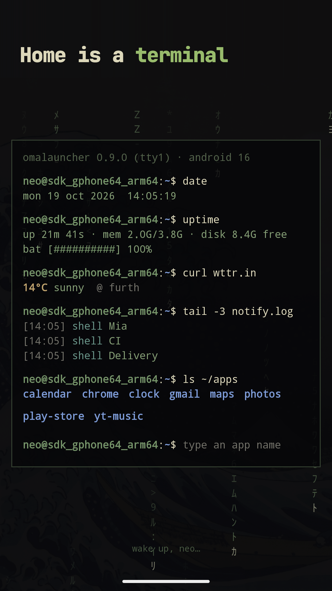

# Omalauncher

> **This is a personal fork of [Omalauncher](https://github.com/SimonSchubert/omalauncher),
> created by [Simon Schubert](https://github.com/SimonSchubert).** The official app is on
> [Google Play](https://play.google.com/store/apps/details?id=dev.omalauncher).
>
> This fork follows upstream and adds its own changes: folders that open out of their tile,
> backup & restore, and icon packs. Its APKs are published on
> [this repository's releases](https://github.com/Mhsbrian/omalauncher/releases) and signed
> with a different key, so they are not the Google Play app: one can't be installed over the
> other, and the original author doesn't support this fork. Please don't report its problems
> upstream.
>
> MIT licensed, like the original ([LICENSE](LICENSE)).

---

An Android home screen with the look of [Omarchy](https://omarchy.org), and an
optional Arch Linux ARM system next to your phone apps. Omalauncher runs the
system under proot, without root, and is its Wayland compositor: every Linux
window opens as its own Android task, with its own card in Recents.

<a href="https://play.google.com/store/apps/details?id=dev.omalauncher"></a>


<p>
  
  
  
  
</p>

- **Themes**: all 22 Omarchy themes, with their wallpapers, applied to the
  launcher and to the Linux apps, plus the community themes from
  [omarchy.org/themes](https://omarchy.org/themes/), or your own in
  `~/.config/omarchy/themes`
- **Widgets** written in OWL, a small declarative language you can edit on the
  phone, plus a [widget store](https://github.com/SimonSchubert/omarchy-widgets)
- **Linux, optional**: pacman and the AUR, Linux apps in their own windows,
  terminal widgets, a file manager, and opt-in GPU acceleration on Mali and Adreno 6xx+ GPUs
- **Coding agents**: the bar at the bottom sends a prompt to Claude Code, Codex,
  Copilot, opencode and others, which open in a terminal
- No account, no ads, no tracking

Needs an arm64 phone with Android 10 or newer. Without Linux, the launcher still
has the themes, wallpapers, Android apps and the widgets that don't run commands.

## Using it

The bar: the one input at the bottom of the home screen opens apps and asks
coding agents. Focusing it opens the list of Linux and Android apps; typing
narrows the list, and Enter opens the highlighted app or sends the text to the
agent. Short queries that name an app open it, sentences go to the agent; Tab
and the arrow keys move the highlight. Tap the agent's name to pick another
installed one; the choice is saved in `~/.config/omalauncher/agent`. Hold the mic to talk and release to send, or tap it to dictate
into the field. Speech is recognized by Android (on the device when the phone
supports it), so only text reaches Linux.

Backup: settings › backup & restore saves the home screen to a file you pick
(pinned apps and folders, widgets with their data, where everything sits, the
theme, style, gestures and language) and restores it from one, showing what the
file holds first and keeping what it replaces so the restore can be undone. It
carries a home screen across an uninstall, a new signing key or a new phone;
Linux itself isn't in it.

Icons: settings › icons picks an icon pack, from the ones installed (icon packs
from the Play Store and F-Droid work) or the ones your agents drew, shows how
many of your apps it covers, and puts the apps it has no icon for on its
backdrop. "+ new pack" has a coding agent draw a whole pack in the style you
describe, in your theme's colors, so it changes with the theme; pick which of
your installed agents draws under "drawn by", and later have it fill in the
icons for apps you installed since, or change the pack. Tap an app there, or
long-press it in the drawer or on home, to give it any pack's icon, a picture,
or one the agent draws. Packs are folders in `~/.config/omalauncher/icon-packs`
and single apps' icons files in `~/.config/omalauncher/icons` (`apps.txt` there
lists the name each app's file takes); SVGs use the theme's colors as
`{{ accent }}`, and `icon-check` shows an icon as the phone draws it. The pack
is `icons.pack` in style.toml.


The app drawer is a widget too, `drawer.owl` in the widgets folder, so an
agent can rewrite it. Here Grok sorts it into folders:


Touch input in Linux windows: tap is a left click, long press is a right
click, drag scrolls; apps with touch support (foot, GTK) get real touch.
Hardware keyboard shortcuts: Super+D (the drawer), Super+T (terminal),
Super+Down (the swipe-down panel), Super+1..9 (home pages) on the home screen;
Super+W (close) in Linux windows. Android keeps Super on its own, Super+Space,
Super+A and Super+Enter for itself, so Omarchy's Super+Space and Super+Enter
can't be used.
Super+Esc leaves a Linux window or a terminal tile without closing it, since
Esc itself is theirs; a gamepad's B (Back) does too, as its buttons stay the
launcher's. On home, in the app drawer, panels and
widgets, the arrows or Tab (a gamepad's D-pad) move between tiles and what
takes taps, past the first or last tile to the next page; Enter (A) opens it
and Menu or holding Enter long-presses it, which selects a home tile for
editing. Right goes into a widget's own buttons, Left back out to its tile.
Up from the bar goes back to the tiles, or into the open drawer.
Enter on a terminal tile goes into it, and Enter there types into it, or
restarts it once it has exited. Esc (B) closes the drawer, a panel or a
widget's screen, like Back. Long text, like a license or a file being
shared, takes the arrows until it has all been shown, Page Up and Page Down a
screenful. On the pages screen, Enter picks a page up by its ≡ and the arrows
move it, until Enter or Esc puts it down. Menu on a notification in the
swipe-down panel dismisses it.

## Building

`scripts/dev.sh setup` gets a machine ready (JDKs, SDK packages, proot, an
emulator) and `scripts/dev.sh doctor` says what's missing; see
[docs/DEVELOPMENT.md](docs/DEVELOPMENT.md). By hand:

```sh
./scripts/fetch-proot.sh          # Termux's proot -> app/src/main/jniLibs (needs bsdtar)
./gradlew :app:installDebug
# optional: skip the 830 MB download on the device
adb push ArchLinuxARM-aarch64-latest.tar.gz /sdcard/Android/data/dev.omalauncher/files/
```

Tests: `./gradlew :owl:test :app:testDebugUnitTest`. `./gradlew :owl:owlJar`
builds `owl/build/cli/owl.jar`, the checker the widget store's CI runs.

In debug builds you can launch guest commands with
`adb shell am start -n dev.omalauncher/.MainActivity --es exec foot`.

- [docs/DEVELOPMENT.md](docs/DEVELOPMENT.md): the dev environment, the
  emulator, what can be tested where, and syncing with upstream
- [AGENTS.md](AGENTS.md): for coding agents working on the code
- [docs/ARCHITECTURE.md](docs/ARCHITECTURE.md): the compositor, rendering, GPU
  acceleration, and how updates reach existing installs
- [docs/RELEASING.md](docs/RELEASING.md): Play releases and store assets
- [app/src/main/assets/widgets/README.md](app/src/main/assets/widgets/README.md):
  the widget language

## Layout

- `app/`: the Android app (Kotlin, Jetpack Compose, and the JNI bridge in `src/main/cpp`)
- `owl/`: the widget language and the `owl` command line, plain Kotlin
- `art/`: SVG masters for the app, agent and store icons
- `store/`: Play listing sources (screenshot frames, privacy policy)
- `fastlane/`: the Play listing and the upload lanes
- `scripts/`: fetching proot and theme colors, rendering icons, screenshots and widget previews

## License

MIT, see [LICENSE](LICENSE), for Omalauncher's own code and artwork. The
coding agents' logos, the symbol font and Omarchy's theme colors are not
covered; [THIRD_PARTY.md](THIRD_PARTY.md) lists them with their sources and
licenses. The app also ships proot, talloc and libandroid-shmem (GPL-2.0,
LGPL-3.0 and BSD-3-Clause, prebuilt by Termux), listed in the app under
settings › licenses.

Omalauncher is an independent project and is not affiliated with or endorsed
by Omarchy, Arch Linux, or the makers of the coding agents it installs.
